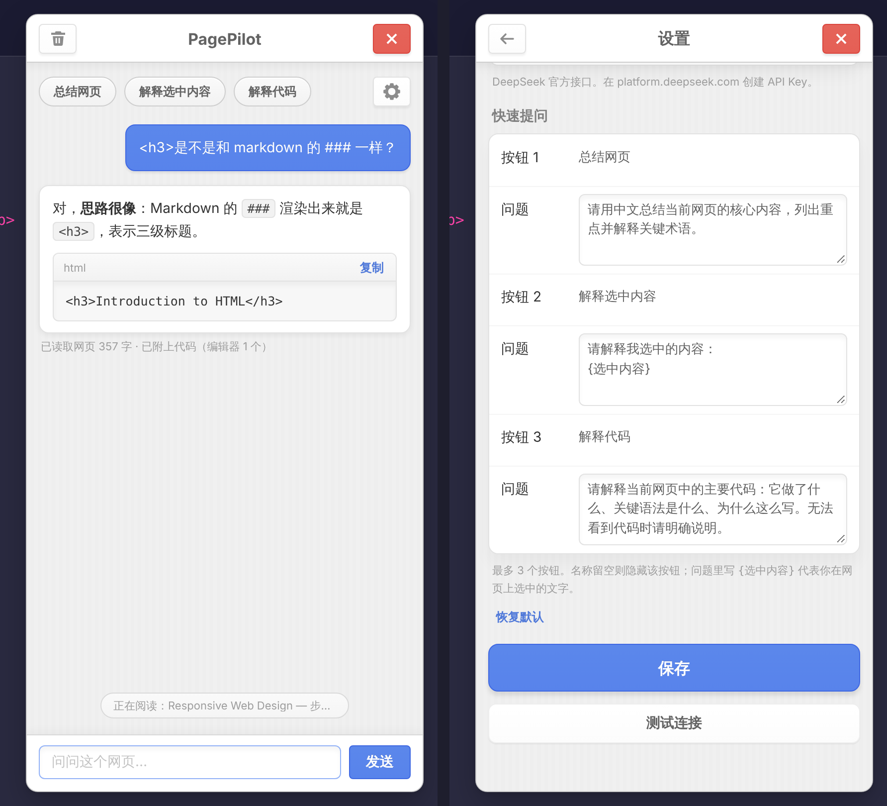
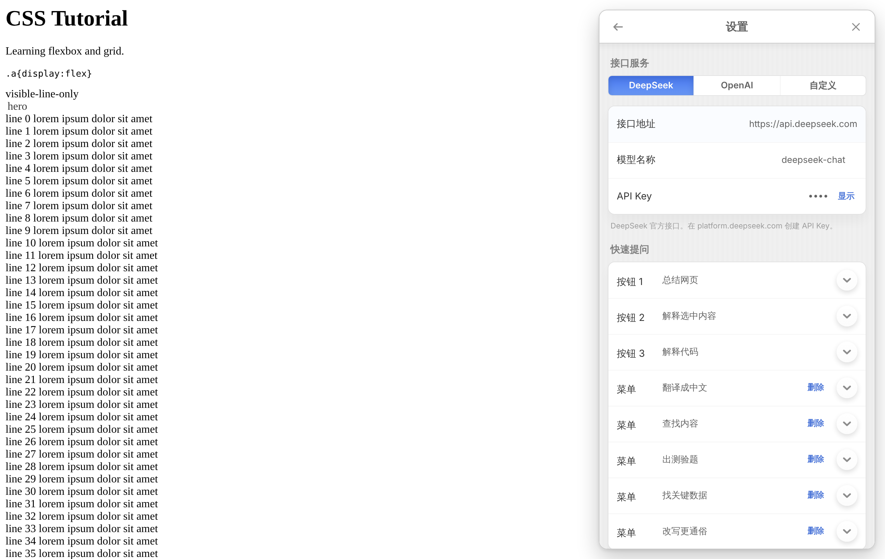
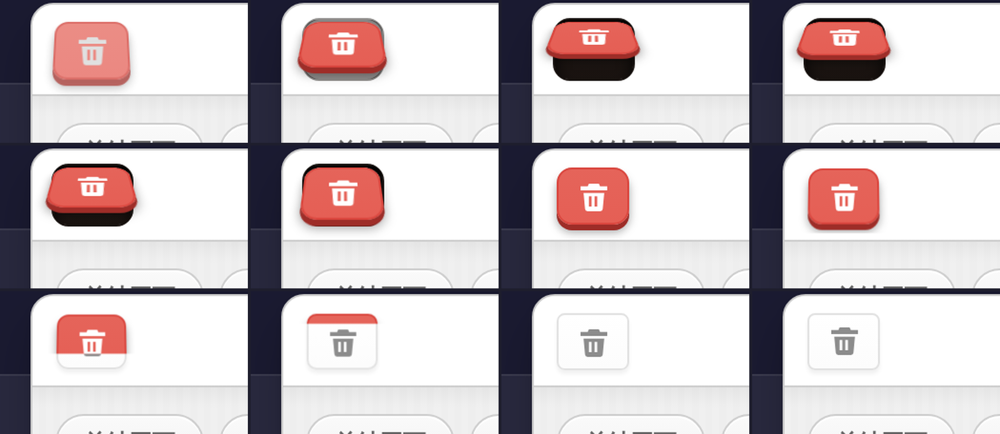
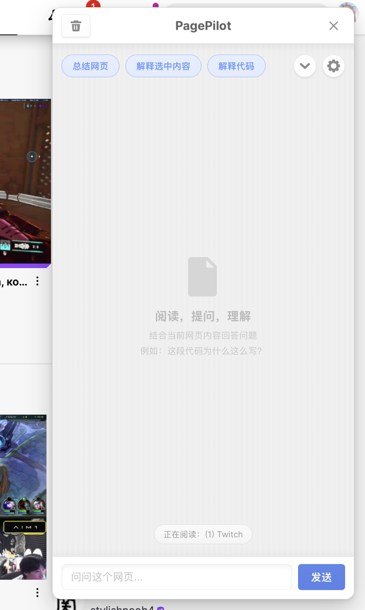
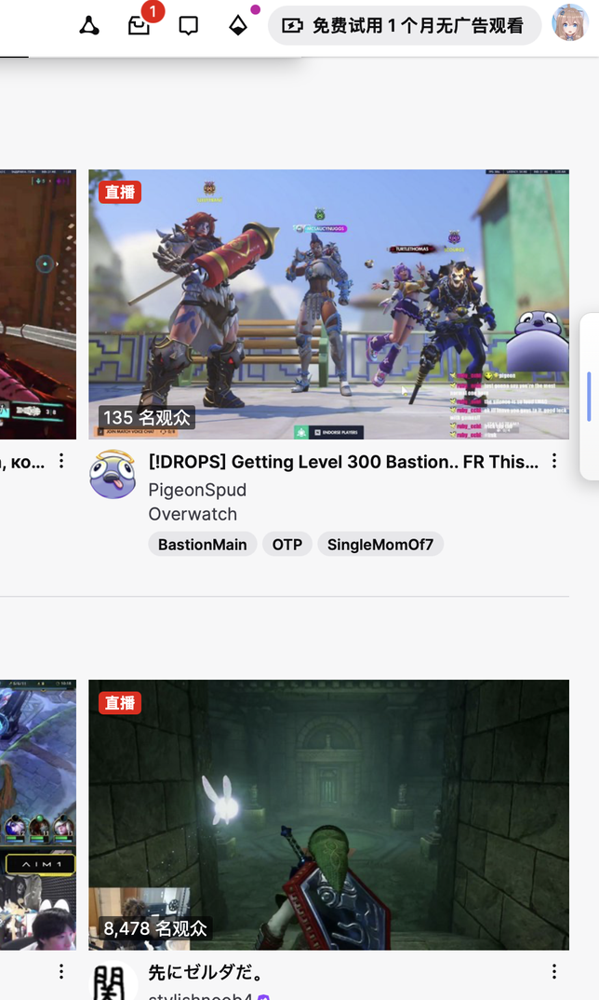
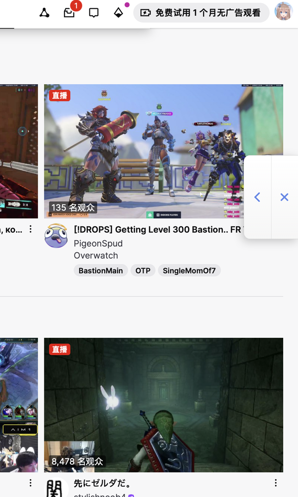

# PagePilot — Safari 网页 AI 助手

无需插件订阅，直接用你自己的 API Key 阅读当前网页并连续提问。界面遵循 Smartisan OS UI 风格（基于 [lemonteaau/smartisan-ui-skill](https://github.com/lemonteaau/smartisan-ui-skill)，详见文末致谢）。

## 界面预览

| 对话与设置 | 设置页 |
|---|---|
|  |  |

清空对话时的「垃圾桶」动效（逐帧）：



收起成边缘竖条，鼠标移上去滑出「‹」展开 /「×」退出（真实 Safari 截图）：

| 展开的对话框 | 点 ✕ 收成右边缘竖条 | 鼠标移上去滑出两个按钮 |
|---|---|---|
|  |  |  |

## 安装（下载 dmg）

1. 从 [GitHub Releases](https://github.com/NorthEX3/Safari_PagePilot/releases) 下载 `PagePilot-<版本>.dmg`，双击打开，把 **PagePilot** 拖到右侧的「应用程序」文件夹。
2. 首次打开 `PagePilot.app` 若被 macOS 拦截：系统设置 → 隐私与安全性 → 点「仍要打开」。
3. 打开 Safari → 设置 → 高级，勾选「在菜单栏中显示“开发”菜单」。
4. 在菜单栏「开发」里勾选 **允许未签名的扩展**。
5. Safari → 设置 → 扩展，勾选 PagePilot 启用。
6. 打开任意网页，点工具栏的 PagePilot 图标；首次使用会进入设置页，填入你的 API Key。

**注意：** 目前的安装包使用本地临时签名，没有经过 Apple Developer ID 签名和公证（以后上班了我自己验证个开发者账号555），所以 Safari **每次重启后都会重置「允许未签名的扩展」**，需要重新勾选一次（第 4 步）。更新版本时下载新的 dmg，把新的 PagePilot 拖进「应用程序」替换旧版，再重启 Safari。

### 自己打包

在装有 Xcode 的 Mac 上：

```bash
scripts/release.sh patch      # 版本号 +0.0.1；也可用 minor / major / 具体版本号 / --no-bump
```

脚本会同步 `extension/manifest.json` 的版本号，生成 Xcode 工程、构建 Release，并在 `dist/` 里产出 `PagePilot-<版本>.dmg` 和 `.zip`。`BUNDLE_ID` 默认是 `com.northex3.PagePilot`，发布后请不要再改；有开发者账号时可用 `SIGN_IDENTITY` 指定签名证书。

## v0.2 相比 v0.1 的变化

**功能**
- 接入任意兼容 OpenAI `/chat/completions` 的服务：内置 DeepSeek / OpenAI 预设，也可填自定义地址（OpenRouter、硅基流动、本机 Ollama 等）；模型名称可自由填写
- 流式逐字输出，可随时「停止」并保留已生成内容
- Markdown 渲染（标题、列表、引用、链接、行内代码、围栏代码块），代码块带「复制」
- 「测试连接」按钮；v0.1 保存的设置自动迁移
- Esc 关闭面板；记住你选中的文字，点进输入框后不会丢失

**清空对话动效（v0.8）**
- 点击左上角垃圾桶：按钮像垃圾桶盖一样以上边为轴、带 3D 透视翻开（约 57°）并渐变成 Smartisan 红、图标变白；盖子是有深红色厚度边的圆角块，下面露出深褐色渐变的桶口和一圈暖灰色桶沿；**对话区**（不含应用栏、快速提问和输入区）被当作**一张完整的纸**，像 Mac 最小化的「神奇效果」那样整体变形成漏斗、被吸进垃圾桶（用透视网格变形，边缘连续无阶梯），收成约盖子一半宽的窄条后从桶口钻进桶里（纸在桶的后面，桶和盖子在前面）；清空后的新页面已在纸的下面；吸完后盖子短暂停留，再加速扣下（带一点回弹），红色盖子随后从下往上收起、露出原来的按钮（不做半透明渐变，不会发粉）。开启系统「减少动态效果」时直接清空，不播放动画

**收起成边缘竖条（v0.17）**
- 点击对话框右上角的叉不再退出，而是把窗口收成贴在页面右边缘的一根细竖条（对话内容、设置、滚动位置都保留；窗口原来的位置恢复为可点击的网页）
- 鼠标放到竖条上（或键盘聚焦、触屏点一下竖条），竖条向左滑出两个按钮：「‹」重新展开对话窗口，「×」才是真正退出
- 展开后蓝色把手消失，两个按钮之间只有一条细细的浅灰色分割线（0.5px）；鼠标放到「×」上时图标变白、这一半的背景变成锤子红
- 展开时，蓝色细条会弯折成「‹」箭头（同一个图标：收起时是一根连续的直线，展开时弯成圆头的箭头，约 0.28 秒，带一点回弹），收回时再变回细条
- 收起时可以上下拖动竖条改变位置（只沿右边缘移动，距上下边缘至少 8px），位置会被记住
- 竖条收起期间，再点一次工具栏的 PagePilot 图标会把窗口展开；按 Esc 不会误关闭已收起的窗口

**复制反馈（v0.16）**
- 点击代码块右上角的「复制」后，「复制」变成一个蓝色的勾，勾像笔画一样从起点画到终点（约 0.34 秒，同时带一点弹性放大），约 1.7 秒后变回「复制」；按钮宽度保持不变，旁边的文字不会挪动；开启系统「减少动态效果」时直接显示勾

**拉宽时拉出更多快速提问（v0.15）**
- 把对话框拉宽时，下拉菜单里的快速提问会按顺序一个个「拉」到按钮那一行（一行排得下才拉，不会因此换行）；拉窄时再收回下拉菜单；宽到全部放得下时，下拉按钮自动消失。新出现的按钮从右边滑进来；收起时标签滑走后不再弹回（修复前会在隐藏前弹回原位 2 帧）；拖动时只搬动真正换位置的标签，标签宽度只量一次并缓存，拖动每帧最多重排一次（拖 60px：旧做法 1200 次 DOM 改动，现在 0 次）

**可调宽度（v0.14）**
- 拖动对话框左边缘可调整宽度：最窄 300px（默认 400px 的 3/4），最宽为页面宽度的一半；会记住你的选择。双击边缘或在边缘上按 Home 恢复 400px；边缘获得焦点后，← → 键每次微调 16px（按住 Shift 为 48px）
- 对话滚动时，内容被裁切的上边缘与快速提问之间的间距从 4px 加到 14px

**思考提示（v0.13.1）**
- 思考和生成期间，标签整体还会像呼吸一样忽明忽暗（透明度 1 ↔ 0.4，周期 1.6 秒，纯透明度动画不占主线程）；回复结束后恢复不透明；开启系统「减少动态效果」时不闪烁
- 发送问题后，不再在对话里先出一个「正在阅读并思考」的气泡；输入框上方的「正在阅读：标题」标签会变成「正在阅读并思考…」，省略号一点、两点、三点循环变化；回答的第一个字出现时对话里才出现回答气泡，但标签一直显示「正在阅读并思考…」直到整段回复生成完毕（或你点了停止），才恢复成「正在阅读：标题」

**设置页的快速提问折叠显示（v0.13）**
- 每一条的「问题」默认隐藏，只显示名称行和右边一个白色圆形箭头按钮；点它展开问题（箭头朝上），再点收起（箭头朝下）。新添加的条目、以及缺少问题内容的条目会自动展开

**关闭按钮（v0.12）**
- 关闭按钮改为 Smartisan BottomSheet 的样式：没有框、不再是红色，只是一个灰色的细叉；按下时变深并弹性放大

**更多快速提问菜单（v0.11）**
- 快速提问按钮改用 Smartisan 的蓝色 Chip（蓝字、白底、浅蓝描边）；设置按钮左边新增一个圆形下拉按钮，点开后在下方一行行展开更多快速提问（同样的蓝色 Label 标签，向下换行排列；对话区会被推下去给它让位，但背景里的条纹和「对话已清空」的空状态图标原地不动，展开和收起全程逐帧对齐、不抽动；先一次性排好最终布局，再只用位移动画演出来，动画期间不再每帧重排版，展开时布局 1 次，旧做法 17 次）（默认带 5 条：翻译成中文、查找内容、出测验题、找关键数据、改写更通俗）
- 设置页里前 3 条是按钮，其余是「菜单」条目，可添加、删除（共最多 12 条），可恢复默认；旧版只存了 3 条的设置会自动补上默认的菜单条目
- 点击其中一个即发送并收起；再点下拉按钮或按 Esc 也会收起

**履带动效（v0.10）**
- 三个快速提问按钮是一条像履带一样的整体：点设置时，整条线快速缩进齿轮里（齿轮顺时针转），随后设置页滑入；从设置页返回时，整条线从齿轮里匀速向左滑出（齿轮逆时针转），按钮之间的间距保持不变，也不会各自翻滚。开启系统「减少动态效果」时不播放

**快速提问可自定义（v0.7）**
- 对话框里的三个快速提问按钮可在设置页修改名称和问题内容；名称留空则隐藏该按钮；问题里写 `{选中内容}` 会替换为你在网页上选中的文字；可一键恢复默认
- 设置按钮（齿轮）在快速提问同一排的最右侧

**智能读取代码（v0.4）**
- 面板会根据你的问题**自动判断意图**，没有开关：问到代码、报错、运行原理、HTML / CSS / 布局、动效 / 「怎么做出来的」/ 技术栈等，才附上对应的额外内容；总结、翻译、问作者这类普通问题不读，不浪费 token。选中了一段像代码的文字再问「这是什么意思」，也会按代码问题处理。每条回答下方的小字会写明这次读取了什么
- 读取内容：页面代码块；编辑器完整内容（Monaco / CodeMirror，通过后台在页面环境中读取，freeCodeCamp 等在线教程适用）；问到 HTML / CSS / 标签 / 选择器 / 布局时，再附上精简的页面结构（只含标签、id、class 和短文字，不含 script / style）
- 问到动效、动画、特效、WebGL、「用了什么技术」时，附上「动效 / 技术线索」：外部脚本与样式表地址、页面里检测到的库（gsap、three.js、Lottie、Swiper、jQuery 等及版本）、`<canvas>` / `<video>` 数量、`@keyframes` 与设置了 animation / transition 的 CSS 规则。另外：页面上正在运行的动画（`document.getAnimations()`，含 CSS animation / transition / JS 创建的 Web Animations）、内联样式里的 animation / transition / transform，以及**脚本片段**——自动下载页面的外部脚本（最多 6 个，跳过 jQuery、统计、广告类），只按 gsap / requestAnimationFrame / `.animate(` / WebGL / IntersectionObserver 等关键词截取前后约 400 字的片段（总计约 8,000 字），**不发送整个文件**。压缩后的代码可读性有限；跨域样式表（常见于 CDN）浏览器不允许读取，会注明数量
- 读不到完整编辑器内容时（例如 Safari 版本不支持），自动退回到编辑器当前可见的文字
- 总量上限约 12,000 字（代码）+ 5,000 字（结构）

**安全**
- 模型输出与网页内容全程用 DOM API 渲染，不使用 innerHTML；链接只允许 http(s)
- 接口地址必须是 https（仅本机地址允许 http），拒绝带账号密码的地址
- 自定义地址只在你点击保存时，才向 Safari 申请访问该主机的权限（`optional_host_permissions`），不默认放开全部网站
- 只有标签页内的内容脚本能使用后台 Key；设置页测试消息只接受扩展自身发出的请求

**性能**
- 流式输出按动画帧合并渲染；只在用户停留在底部时自动滚动
- 网页正文超长时保留开头 15,000 + 结尾 5,000 字，并告知模型已省略中间内容（v0.1 只截开头）
- 历史对话只保留问答本身，旧的网页快照不会重复发送，节省 token


## 其他安装方法一：Mac Safari 快速试用（不用 Xcode）

> 要求：支持 **临时网页扩展** 功能的新版 macOS Safari。此安装属于开发测试模式。

1. 下载或克隆本仓库，其中的 `extension/` 文件夹（里面有 `manifest.json`）就是要加载的扩展。
2. 在 Safari → 设置 → 高级，启用「显示网页开发者功能」（旧版为显示开发菜单）。
3. Safari → 设置 → 开发者，勾选 **允许未签名的扩展 / Allow unsigned extensions**。
4. 仍在 **开发者** 标签页，点击 **添加临时扩展… / Add Temporary Extension…**，选中 `extension/` 文件夹。
5. Safari → 设置 → 扩展，确保 PagePilot 已启用。
6. 打开普通网页（例如技术文档或 GitHub），点击 Safari 工具栏中的 PagePilot 图标，右侧直接打开对话框（再点一次关闭）。首次使用会自动进入设置页。
7. 在设置页选择接口服务，填入 **API Key**（如 https://platform.deepseek.com/ 创建的 Key），点「测试连接」确认后点「保存」。之后点对话框左上角的齿轮即可随时回到设置。
8. Safari 若提示允许扩展访问本网站，请允许本次访问。
9. 更新代码后，在 Safari → 设置 → 扩展 里选中 PagePilot，点「重新加载」即可，不必删除重装。

**注意：** Apple 说明，临时安装的 Safari 扩展会在 **退出 Safari 或 24 小时后移除**。这是测试安装的正常行为。

官方步骤：https://developer.apple.com/documentation/safariservices/running-your-safari-web-extension

## 其他安装方法二：手动转换成 Xcode 工程（需要 Mac + Xcode）

`scripts/release.sh` 做的就是这件事。想自己在 Xcode 里调试时，可手动执行：

```bash
xcrun safari-web-extension-converter extension/ \
  --project-location ~/Desktop/PagePilot-Xcode \
  --app-name PagePilot \
  --bundle-identifier com.example.pagepilot \
  --macos-only
```

生成工程后在 Xcode 中选择你的 Personal Team，Build & Run，再在 Safari → 设置 → 扩展中启用。较新的 Xcode 也提供同名参数的 `safari-web-extension-packager`。

官方说明：https://developer.apple.com/documentation/safariservices/packaging-a-web-extension-for-safari

## 安全与费用

- 代码没有任何插件订阅费用或自己的服务端。**DeepSeek API 的调用费用单独计费**。
- API Key 通过扩展自身的 `storage.local` 持久保存；它与网页 DOM 隔离，但**并非 macOS 钥匙串 / Keychain 加密保护**，请不要把含有 API Key 的浏览器配置文件分享给其他人。可在对话框的设置页替换 Key，或删除扩展保存的数据。
- 每次点击「发送」「总结」等操作时，才将当前网页正文（最多约 20,000 字符）、页面 URL、标题以及最近聊天历史发送给你配置的接口（默认 `https://api.deepseek.com/chat/completions`）。
- 每次提问都会读取并发送当前网页（没有单独的开关）；「智能读取代码」开关只控制是否额外附上代码、编辑器内容和动效线索。不想让网页内容离开浏览器时，请不要在该页面提问。
- 不要在银行、邮箱、私有合同、未公开论文等敏感网页上随意使用；只授权你信任的站点。
- API Key 请在 **扩展自己的弹窗**中填写，**不要**在网页侧边栏消息框或聊天中明文发送。

## 已知限制

- **Safari 原生固定侧边栏并非通用扩展 API。** 当前使用 **网页内的右侧浮层**，会遮挡网页右侧内容；不是 Safari 浏览器原生侧边栏。
- 无法自动读取跨域 `iframe`、视频字幕、Canvas/WebGL、某些动态编辑器（包括 Scrimba 的嵌入式代码环境）；可选中真实文字后提问。
- 仅发送网页文本，不截屏、也不会访问视频画面；不是自动浏览网站的 Agent。
- 聊天记录仅保留在当前页面会话，关闭面板或刷新后消失。
- **ChatGPT Plus 订阅不能直接用作 OpenAI API Key**；使用 OpenAI 需单独创建 API Key 并按量计费。
- 界面只有浅色主题（Smartisan OS 本身没有暗色模式）。

## 工程目录

```
extension/
  manifest.json       扩展声明、最低权限
  background.js       后台流式请求 API（持有 API Key）
  content.js          点击工具栏图标时注入的右侧对话框，内含设置页（接口预设 / 地址 / 模型 / Key / 测试连接）
  icon*.png           工具栏和扩展图标
docs/screenshots/   README 用到的界面截图
design/             应用图标源文件（icon.svg）与 1024px 预览
scripts/
  release.sh          同步版本号 → 构建 → 打包 dmg / zip
tests/
  test-background.js  后台逻辑离线测试
  test-ui.js          侧边栏 Chromium 测试
  test-icons.js       图标清单检查
```

## 图标

- 应用图标：带折角的网页 + 蓝色纸飞机徽章（Smartisan 风格）。可编辑源文件 `design/icon.svg`，1024px 预览 `design/icon-1024.png`，扩展使用 `extension/icon32.png` / `icon48.png` / `icon128.png`
- `node tests/test-icons.js` 检查清单引用的图标都存在、尺寸正确、带透明通道

## 参考

- Apple Safari Web Extensions: https://developer.apple.com/documentation/safariservices/safari-web-extensions
- Apple temporary install: https://developer.apple.com/documentation/safariservices/running-your-safari-web-extension
- DeepSeek 官方接口: https://api-docs.deepseek.com/api/create-chat-completion/

## 致谢与许可

- 本项目代码使用 [MIT](LICENSE) 许可。
- 界面风格来自 [smartisan-ui-skill](https://github.com/lemonteaau/smartisan-ui-skill)（作者 [lemonteaau](https://github.com/lemonteaau)），它整理了 Smartisan OS 的设计 token 与交互参数。
- 设计来源：[Smartisan OS UI Kit (Unofficial)](https://www.figma.com/community/file/1419385240874679870)，作者 [Paix Chan](https://www.figma.com/@paixchan)，按 [CC BY 4.0](https://creativecommons.org/licenses/by/4.0/) 授权；界面中的图标与样式参考自该文件，沿用 CC BY 4.0 署名要求。
- 交互参数间接参考了社区复刻项目 [SmartisanMusic-Revived](https://github.com/Mangi-11/SmartisanMusic-Revived) 等（经由上述 skill）。
